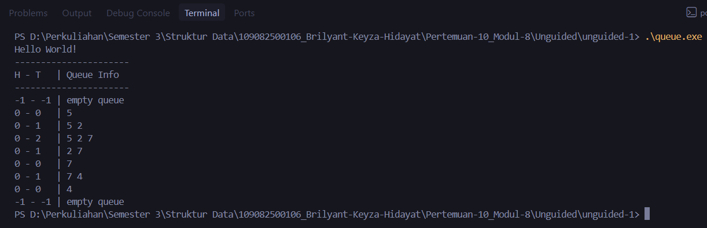
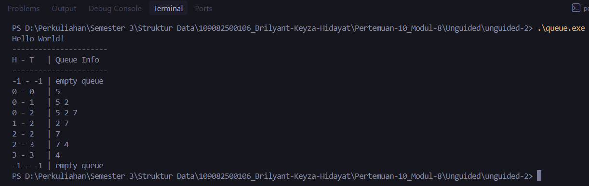
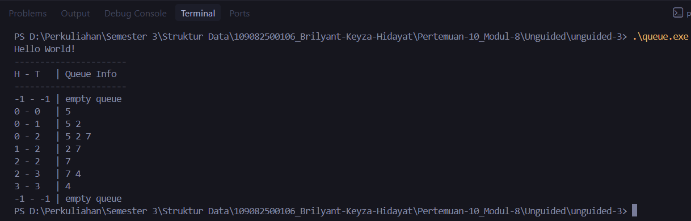

# <h1 align="center">Laporan Praktikum Modul 8 - QUEUE</h1>
<p align="center">Brilyant Keyza Hidayat - 109082500106</p>

## Dasar Teori

### A. Pengertian Queue
Queue (antrean) adalah salah satu bentuk struktur data linear yang menerapkan prinsip operasi FIFO (*First In, First Out*), yaitu elemen yang pertama kali masuk ke dalam antrean akan menjadi elemen pertama yang diakses atau dikeluarkan [1]. Struktur ini dapat diumpamakan seperti antrean pada loket pembelian tiket kereta api, di mana orang yang datang paling awal akan mendapatkan pelayanan terlebih dahulu dan yang datang paling akhir akan dilayani terakhir pula [2]. Dalam pengelolaannya, queue memiliki dua penanda utama, yakni **Head** sebagai penunjuk elemen paling depan tempat penghapusan dilakukan dan **Tail** sebagai penunjuk elemen paling belakang tempat penyisipan elemen baru dilakukan [2].

### B. Operasi-Operasi Dasar dalam Queue
Sesuai dengan sifat FIFO, manipulasi data pada struktur queue bertumpu pada dua operasi inti beserta beberapa fungsi primitif pendukungnya \[2\]:

* **Enqueue (Insert):** Operasi penambahan elemen baru yang selalu dilakukan pada ujung belakang antrean (`tail`). Jika antrean masih kosong, `head` dan `tail` akan langsung menunjuk ke elemen baru tersebut; jika sudah terisi, elemen baru dikaitkan atau diletakkan setelah posisi `tail` dan penunjuk `tail` diperbarui.

* **Dequeue (Delete):** Operasi pengambilan atau penghapusan elemen yang selalu dilakukan pada ujung depan antrean (`head`). Setelah elemen di posisi `head` diambil, penunjuk `head` digeser ke elemen berikutnya, atau dikembalikan ke kondisi kosong apabila elemen yang dihapus merupakan satu-satunya elemen tersisa.

* **Operasi Primitif Pendukung:** Meliputi inisialisasi antrean kosong (`CreateQueue`), pengecekan kondisi antrean (`isEmpty` dan `isFull`), penelusuran untuk menampilkan seluruh isi antrean (`printInfo` atau `viewQueue`), serta manajemen memori (`alokasi` dan `dealokasi`) khusus untuk representasi pointer \[2\].

### C. Representasi Queue (Pointer dan Tabel)
Struktur data queue dapat diimplementasikan menggunakan dua jenis representasi fisik, yaitu **Pointer (Linked List)** dan **Tabel (Array)** \[2\]. Pada representasi pointer, kapasitas antrean bersifat tidak terbatas (dinamis) namun memerlukan manajemen memori secara eksplisit. Sebaliknya, pada representasi tabel (array), jumlah kapasitas antrean terbatas sesuai ukuran maksimum array (`IMax`) dan tidak memerlukan manajemen memori dinamis.

Untuk representasi tabel (array), terdapat tiga mekanisme alternatif pergerakan indeks `head` dan `tail` \[2\]:

* **Alternatif 1 (Head diam, Tail bergerak):** Posisi `head` selalu tetap di indeks awal selama queue tidak kosong. Saat terjadi `dequeue`, seluruh elemen di belakang `head` digeser maju satu posisi dan `tail` dimundurkan. Mekanisme ini mudah dipahami namun kurang efisien karena selalu melakukan pergeseran elemen.

* **Alternatif 2 (Head bergerak, Tail bergerak):** Saat terjadi `dequeue`, elemen tidak digeser melainkan indeks `head` yang dimajukan. Cara ini lebih efisien, tetapi dapat menimbulkan kondisi penuh "semu" ketika `tail` telah mencapai indeks maksimum sementara masih ada ruang kosong di bagian depan array, sehingga pergeseran baru dilakukan saat kondisi tersebut terjadi.

* **Alternatif 3 (Head dan Tail berputar / *Circular Buffer*):** Indeks `head` dan `tail` dirancang bergerak melingkar kembali ke indeks awal setelah mencapai indeks maksimum menggunakan operasi modulo. Mekanisme ini sangat efisien karena meniadakan kebutuhan penggeseran elemen secara menyeluruh.

## Guided

### 1. Implementasi Queue Menggunakan Pointer (Linked List)

#### queue.h

```C++
#ifndef QUEUE_H_INCLUDE
#define QUEUE_H_INCLUDE

#include <iostream>
using namespace std;

#define Nil NULL

typedef bool boolean;
typedef int infotype;
typedef struct elmQ *address;

struct elmQ{
   infotype info;
   address next;
};

struct queue {
   address head, tail;
};

boolean isEmpty(queue Q);
void CreateQueue(queue &Q);
address alokasi(infotype X);
void dealokasi(address P);
address findElm(queue Q, infotype X);
boolean fFindElm(queue Q, address P);
void insert(queue &Q, address P);
void deleteQueue(queue &Q, address &P);
void printInfo(queue Q);
int nbList(queue Q);
void delAll(queue &Q);

#endif

```

#### queue.cpp

```C++
#include "queue.h"

boolean isEmpty(queue Q) {
    return (Q.head == Nil);
}

void CreateQueue(queue &Q) {
    Q.head = Nil;
    Q.tail = Nil;
}

address alokasi(infotype X) {
    address P = new (nothrow) elmQ;
    if (P != Nil) {
        P->info = X;
        P->next = Nil;
    }
    return P;
}

void dealokasi(address P) {
    delete P;
}

address findElm(queue Q, infotype X) {
    address P = Q.head;
    while (P != Nil) {
        if (P->info == X) {
            return P;
        }
        P = P->next;
    }
    return Nil;
}

boolean fFindElm(queue Q, address P) {
    address R = Q.head;
    while (R != Nil) {
        if (R == P) {
            return true;
        }
        R = R->next;
    }
    return false;
}

void insert(queue &Q, address P) { //enqueue
    if (isEmpty(Q)) {
        Q.head = P;
        Q.tail = P;
    } else {
        (Q.tail)->next = P;
        Q.tail = P;
    }
}

void deleteQueue(queue &Q, address &P) { //dequeue
    P = Q.head;
    if (Q.head == Q.tail) {
        Q.head = Nil;
        Q.tail = Nil;
    } else {
        Q.head = P->next;
    }
    P->next = Nil;
}

void printInfo(queue Q) {
    if (isEmpty(Q)) {
        cout << "Queue kosong" << endl;
    } else {
        address P = Q.head;
        while (P != Nil) {
            cout << P->info << " ";
            P = P->next;
        }
        cout << endl;
    }
}

int nbList(queue Q) {
    int jumlah = 0;
    address P = Q.head;
    while (P != Nil) {
        jumlah++;
        P = P->next;
    }
    return jumlah;
}

void delAll(queue &Q) {
    address P;
    while (!isEmpty(Q)) {
        deleteQueue(Q, P);
        dealokasi(P);
    }
}

```

#### main.cpp

```C++
#include <iostream>
#include "queue.h"
using namespace std;

int main() {
    queue Q;
    address P; 

    CreateQueue(Q);
    cout << "isEmpty : " << isEmpty(Q) << endl;
    printInfo(Q);

    insert(Q, alokasi(5));
    insert(Q, alokasi(2));
    insert(Q, alokasi(7));
    cout << "Setelah insert 5, 2, 7" << endl;
    printInfo(Q);
    cout << "nbList  : " << nbList(Q) << endl;

    P = findElm(Q, 2);
    if (P != Nil) {
        cout << "findElm(2) ketemu, info = " << P->info << endl;
        cout << "fFindElm : " << fFindElm(Q, P) << endl;
    }
    if (findElm(Q, 9) == Nil) {
        cout << "findElm(9) tidak ketemu" << endl;
    }

    deleteQueue(Q, P);
    cout << "Setelah delete, elemen yang keluar = " << P->info << endl;
    dealokasi(P);
    printInfo(Q);

    delAll(Q);
    cout << "Setelah delAll" << endl;
    printInfo(Q);
    cout << "isEmpty : " << isEmpty(Q) << endl;

    return 0;
}

```

Program guided 1 ini berfungsi untuk mengimplementasikan struktur data Queue menggunakan representasi pointer (*Singly Linked List*) dengan dua penunjuk utama `head` dan `tail`. Cara kerjanya dimulai dengan inisialisasi antrean kosong (`CreateQueue`), dilanjutkan pengalokasian simpul memori dinamis (`alokasi`) untuk menambahkan data bertipe integer ke belakang antrean (`insert`), lalu menampilkan isi beserta jumlah elemennya (`printInfo` dan `nbList`). Program juga menerapkan operasi pencarian berdasarkan nilai maupun alamat (`findElm` dan `fFindElm`), penghapusan elemen terdepan (`deleteQueue`) disertai pembebasan memori (`dealokasi`), hingga pengosongan seluruh isi antrean sekaligus melalui prosedur `delAll`.

### 2. Implementasi Queue Menggunakan Array (Representasi Tabel)

#### queue-array.h

```C++
#ifndef QUEUE_H
#define QUEUE_H

#include <iostream>
using namespace std;

const int MAKSIMAL = 5;

struct queue {
    string nama[MAKSIMAL];
    int head;
    int tail;
};

bool isFull(queue Q);
bool isEmpty(queue Q);
void CreateQueue(queue &Q);
void enQueue(queue &Q, string nama);
void deQueue(queue &Q);
void viewQueue(queue Q);

#endif

```

#### queue-array.cpp

```C++
#include "queue-array.h"
#include <iostream>

using namespace std;

// NOTE : 
// Implementasi 1 = head diam, tail bergerak (Queue Linear Statis, kerana head nya tetap diam)
// Implementasi 2 = head bergerak, tail bergerak (Queue Linear Dinamis, karena head & tail nya sama-sama bergerak)
// Implementasi 3 = head dan tail berputar (Queue Circular, karena jika udh mentok tapi masih ada space, diputar sehingga tail bisa ada didepan head)

bool isEmpty(queue Q){
    if(Q.head == -1 && Q.tail == -1){
        return true;
    } else {
        return false;
    }
}

//isFull implmenetasi 1
bool isFull(queue Q){
    if(Q.tail == MAKSIMAL - 1){
        return true;
    } else {
        return false;
    }
}

// //isFull implementasi 2
// bool isFull(queue Q){
//     if(Q.head == 0 && Q.tail == MAKSIMAL - 1){
//         return true;
//     } else {
//         return false;
//     }
// }

// //isFull implementasi 3
// bool isFull(queue Q){
//     if((Q.tail + 1) % MAKSIMAL == Q.head){
//         return true;
//     } else {
//         return false;
//     }
// }

void CreateQueue(queue &Q){ //terbentuk queue dengan head = -1 dan tail = -1 
    Q.head = -1;
    Q.tail = -1;
}
 

//enqueue implementasi 1
void enQueue(queue &Q, string nama){
    if(isFull(Q) == true){
        cout << "Queue sudah penuh!" << endl;
    } else {
        if(isEmpty(Q) == true){
            Q.head = Q.tail = 0;
        } else {
            Q.tail++;
        }
        Q.nama[Q.tail] = nama;
        cout << "nama " << nama << " berhasil ditambahkan kedalam queue!" << endl;
    }
}

// //enQueue implementasi 2
// void enQueue(queue &Q, string nama){
//     if(isFull(Q) == true){
//         cout << "Queue sudah penuh!" << endl;
//     } else {
//         if(isEmpty(Q) == true){
//             Q.head = Q.tail = 0;
//         } else {
//             if(Q.tail == MAKSIMAL - 1){ // penuh semu, geser elemen ke kiri
//                 int selisih = Q.head;
//                 for(int i = Q.head; i <= Q.tail; i++){
//                     Q.nama[i - selisih] = Q.nama[i];
//                 }
//                 Q.tail = Q.tail - selisih;
//                 Q.head = 0;
//             }
//             Q.tail++;
//         }
//         Q.nama[Q.tail] = nama;
//         cout << "nama " << nama << " berhasil ditambahkan kedalam queue!" << endl;
//     }
// }

// //enQueue implementasi 3
// void enQueue(queue &Q, string nama){
//     if(isFull(Q) == true){
//         cout << "Queue sudah penuh!" << endl;
//     } else {
//         if(isEmpty(Q) == true){
//             Q.head = Q.tail = 0;
//         } else {
//             Q.tail = (Q.tail + 1) % MAKSIMAL; // bergerak melingkar
//         }
//         Q.nama[Q.tail] = nama;
//         cout << "nama " << nama << " berhasil ditambahkan kedalam queue!" << endl;
//     }
// }

//dequeue implementasi 1
void deQueue(queue &Q){
    if(isEmpty(Q) == true){
        cout << "Queue kosong!" << endl;
    } else {
        cout << "Mengahapus data " << Q.nama[Q.head] << "..." << endl;
        for(int i = 0; i < Q.tail; i++){
            Q.nama[i] =  Q.nama[i+1];
        }
        Q.tail--;
        if(Q.tail < 0){ //kalo semua isi queue nya udh dikeluarin, set head & tail ke -1
            Q.head = -1;
            Q.tail = -1;
        }
    }
}

// //dequeue implementasi 2
// void deQueue(queue &Q){
//     if(isEmpty(Q) == true){
//         cout << "Queue kosong!" << endl;
//     } else {
//         cout << "Mengahapus data " << Q.nama[Q.head] << "..." << endl;
//         Q.head++;
//         if(Q.head > Q.tail){ //kalo elemennya udh abis (head akan lebih 1 dari tail), maka reset ulang head & tail ke -1
//             Q.head = -1;
//             Q.tail = -1;
//         }
//     }
// }

// //deQueue implementasi 3
// void deQueue(queue &Q){
//     if(isEmpty(Q) == true){
//         cout << "Queue kosong!" << endl;
//     } else {
//         cout << "Mengahapus data " << Q.nama[Q.head] << "..." << endl;
//         if(Q.head == Q.tail){ //kalo elemennya tinggal 1, langsungkan saja head & tail nya reset ke -1
//             Q.head = -1;
//             Q.tail = -1;
//         } else {
//             Q.head = (Q.head + 1) % MAKSIMAL; // bergerak melingkar
//         }
//     }
// }

//viewQueue implementasi 1 & 2
void viewQueue(queue Q){
    if(isEmpty(Q) == true){
        cout << "Queue kosong!" << endl;
    } else {
        for(int i = Q.head; i <= Q.tail; i++){
            cout << i -  Q.head + 1 << ". " << Q.nama[i] << endl;
        }
    }
    cout << endl;
}

// //viewQueue implementasi 3
// void viewQueue(queue Q){
//     if(isEmpty(Q) == true){
//         cout << "Queue kosong!" << endl;
//     } else {
//         int i = Q.head;
//         int count = 1;
//         while(true){
//             cout << count << ". " << Q.nama[i] << endl;
//             if(i == Q.tail){
//                 break;
//             }
//             i = (i + 1) % MAKSIMAL;
//             count++;
//         }   
//     }
// }
```

#### main.cpp

```C++
#include "queue-array.h"
#include <iostream>

using namespace std;

int main(){
    queue Q;

    CreateQueue(Q);
    enQueue(Q, "Dimas");
    enQueue(Q, "Arvin");
    enQueue(Q, "Rizal");
    enQueue(Q, "Hafizh");
    enQueue(Q, "Fathur");
    enQueue(Q, "Daffa");
    cout << endl;

    cout << "--- Isi Queue Setelah enQueue ---" << endl;
    viewQueue(Q);
    cout << endl;

    deQueue(Q);
    deQueue(Q);
    deQueue(Q);
    deQueue(Q);
    // deQueue(Q);
    // deQueue(Q);
    cout << endl;

    cout << "--- Isi Queue Setelah deQueue ---" << endl;
    viewQueue(Q);

    return 0;
}
```

Program guided 2 ini berfungsi untuk mengelola antrean nama bertipe `string` menggunakan struktur Queue berbasis array dengan kapasitas maksimal 5 elemen (`MAKSIMAL = 5`). Secara aktif, program menerapkan mekanisme Alternatif 1 (*head* diam di indeks 0, *tail* bergerak) dengan fungsi pengecekan `isEmpty` dan `isFull`, penambahan data `enQueue` yang otomatis menolak input keenam saat array penuh, serta penghapusan `deQueue` yang menggeser seluruh elemen tersisa ke kiri sebelum mencetak daftar nama yang masih mengantre melalui `viewQueue`, sembari menyertakan referensi implementasi Alternatif 2 dan Alternatif 3 di dalam komentarnya.

## Unguided

### 1. Buatlah ADT Queue menggunakan ARRAY sebagai berikut di dalam file "queue.h":

```
Type infotype : integer
Type Queue : <
    info : array [5] of infotype {index array dalam C++ dimulai dari 0}
    head, tail : integer
>
procedure CreateQueue (input/output Q : Queue)
function isEmptyQueue (Q : Queue) -> boolean
function isFullQueue (Q : Queue) -> boolean
procedure enqueue (input/output Q : Queue, input x : infotype)
function dequeue (input/output Q : Queue) -> infotype
procedure printInfo (input Q : Queue)

```

Buatlah implementasi ADT Queue pada file "queue.cpp" dengan menerapkan mekanisme queue Alternatif 1 (head diam, tail bergerak).

#### queue.h

```C++
#ifndef QUEUE_H
#define QUEUE_H

typedef int infotype;

struct Queue {
    infotype info[5];
    int head;
    int tail;
};

void createQueue(Queue &Q);
bool isEmptyQueue(Queue Q);
bool isFullQueue(Queue Q);
void enqueue(Queue &Q, infotype x);
infotype dequeue(Queue &Q);
void printInfo(Queue Q);

#endif

```

#### queue.cpp

```C++
#include <iostream>
#include "queue.h"
using namespace std;

void createQueue(Queue &Q) {
    Q.head = -1;
    Q.tail = -1;
}

bool isEmptyQueue(Queue Q) {
    return (Q.head == -1 && Q.tail == -1);
}

bool isFullQueue(Queue Q) {
    return (Q.tail == 4);
}

void enqueue(Queue &Q, infotype x) {
    if (isFullQueue(Q)) {
        cout << "Queue penuh!" << endl;
    } else {
        if (isEmptyQueue(Q)) {
            Q.head = 0;
            Q.tail = 0;
        } else {
            Q.tail++;
        }
        Q.info[Q.tail] = x;
    }
}

infotype dequeue(Queue &Q) {
    if (isEmptyQueue(Q)) {
        cout << "Queue kosong!" << endl;
        return -1;
    } else {
        infotype x = Q.info[Q.head];
        if (Q.head == Q.tail) {
            Q.head = -1;
            Q.tail = -1;
        } else {
            for (int i = Q.head; i < Q.tail; i++) {
                Q.info[i] = Q.info[i + 1];
            }
            Q.tail--;
        }
        return x;
    }
}

void printInfo(Queue Q) {
    cout << Q.head << " - " << Q.tail << "\t| ";
    if (isEmptyQueue(Q)) {
        cout << "empty queue" << endl;
    } else {
        for (int i = Q.head; i <= Q.tail; i++) {
            cout << Q.info[i] << " ";
        }
        cout << endl;
    }
}

```

#### main.cpp

```C++
#include <iostream>
#include "queue.h"
using namespace std;

int main() {
    cout << "Hello world!" << endl;
    Queue Q;
    createQueue(Q);

    cout << "----------------------" << endl;
    cout << "H - T \t| Queue Info" << endl;
    cout << "----------------------" << endl;

    printInfo(Q);
    enqueue(Q, 5); printInfo(Q);
    enqueue(Q, 2); printInfo(Q);
    enqueue(Q, 7); printInfo(Q);
    dequeue(Q);    printInfo(Q);
    dequeue(Q);    printInfo(Q);
    enqueue(Q, 4); printInfo(Q);
    dequeue(Q);    printInfo(Q);
    dequeue(Q);    printInfo(Q);

    return 0;
}
```

### Output Unguided 1 :

##### Output 1




Program ini berfungsi untuk mengimplementasikan ADT Queue berbasis array berkapasitas 5 elemen bertipe integer menggunakan mekanisme Alternatif 1 (*head* diam, *tail* bergerak). Secara cara kerjanya, `createQueue` menginisialisasi `head` dan `tail` bernilai `-1` sebagai tanda antrean kosong, lalu `enqueue` menyisipkan data dengan memajukan `tail` selama belum mencapai indeks maksimal `4`. Saat `dequeue` dijalankan, program mengambil nilai di posisi `head`, kemudian menggeser seluruh elemen yang tersisa ke kiri satu langkah dan memundurkan `tail` agar `head` selalu menetap di indeks `0` hingga antrean kembali kosong, sembari mencetak perubahan posisi `H - T` dan isi antrean melalui `printInfo`.

### 2. Buatlah implementasi ADT Queue pada file "queue.cpp" dengan menerapkan mekanisme queue Alternatif 2 (head bergerak, tail bergerak).

#### queue.h

```C++
#ifndef QUEUE_H
#define QUEUE_H

typedef int infotype;

struct Queue {
    infotype info[5];
    int head;
    int tail;
};

void createQueue(Queue &Q);
bool isEmptyQueue(Queue Q);
bool isFullQueue(Queue Q);
void enqueue(Queue &Q, infotype x);
infotype dequeue(Queue &Q);
void printInfo(Queue Q);

#endif

```

#### queue.cpp

```C++
#include <iostream>
#include "queue.h"
using namespace std;

void createQueue(Queue &Q) {
    Q.head = -1;
    Q.tail = -1;
}

bool isEmptyQueue(Queue Q) {
    return (Q.head == -1 && Q.tail == -1);
}

bool isFullQueue(Queue Q) {
    return (Q.head == 0 && Q.tail == 4);
}

void enqueue(Queue &Q, infotype x) {
    if (isFullQueue(Q)) {
        cout << "Queue penuh!" << endl;
    } else {
        if (isEmptyQueue(Q)) {
            Q.head = 0;
            Q.tail = 0;
        } else {
            // Perubahan untuk soal no 2
            if (Q.tail == 4) {
                int j = 0;
                for (int i = Q.head; i <= Q.tail; i++) {
                    Q.info[j] = Q.info[i];
                    j++;
                }
                Q.head = 0;
                Q.tail = j - 1;
            }
            Q.tail++;
        }
        Q.info[Q.tail] = x;
    }
}

infotype dequeue(Queue &Q) {
    if (isEmptyQueue(Q)) {
        cout << "Queue kosong!" << endl;
        return -1;
    } else {
        infotype x = Q.info[Q.head];
        if (Q.head == Q.tail) {
            Q.head = -1;
            Q.tail = -1;
        } else {
            // Perubahan untuk soal no 2
            Q.head++;
        }
        return x;
    }
}

void printInfo(Queue Q) {
    cout << Q.head << " - " << Q.tail << "\t| ";
    if (isEmptyQueue(Q)) {
        cout << "empty queue" << endl;
    } else {
        for (int i = Q.head; i <= Q.tail; i++) {
            cout << Q.info[i] << " ";
        }
        cout << endl;
    }
}

```

#### main.cpp

```C++
#include <iostream>
#include "queue.h"
using namespace std;

int main() {
    cout << "Hello world!" << endl;
    Queue Q;
    createQueue(Q);

    cout << "----------------------" << endl;
    cout << "H - T \t| Queue Info" << endl;
    cout << "----------------------" << endl;

    printInfo(Q);
    enqueue(Q, 5); printInfo(Q);
    enqueue(Q, 2); printInfo(Q);
    enqueue(Q, 7); printInfo(Q);
    dequeue(Q);    printInfo(Q);
    dequeue(Q);    printInfo(Q);
    enqueue(Q, 4); printInfo(Q);
    dequeue(Q);    printInfo(Q);
    dequeue(Q);    printInfo(Q);

    return 0;
}

```

### Output Unguided 2 :

##### Output 1




Program ini merupakan modifikasi implementasi Queue array yang menerapkan mekanisme Alternatif 2 (*head* bergerak, *tail* bergerak). Secara cara kerjanya, operasi `dequeue` menjadi lebih efisien karena tidak lagi menggeser elemen array setiap kali data dihapus, melainkan cukup memajukan indeks `head` (`head++`) selama masih tersisa elemen lain. Antrean hanya dianggap penuh sepenuhnya oleh `isFullQueue` apabila `head == 0` dan `tail == 4`, sehingga jika terjadi kondisi penuh semu (`tail == 4` namun `head > 0`) pada saat `enqueue`, barulah program menggeser seluruh elemen aktif kembali ke awal array mulai indeks `0` untuk membuka ruang kosong di belakang.

### 3. Buatlah implementasi ADT Queue pada file "queue.cpp" dengan menerapkan mekanisme queue Alternatif 3 (head dan tail berputar).

#### queue.h

```C++
#ifndef QUEUE_H
#define QUEUE_H

typedef int infotype;

struct Queue {
    infotype info[5];
    int head;
    int tail;
};

void createQueue(Queue &Q);
bool isEmptyQueue(Queue Q);
bool isFullQueue(Queue Q);
void enqueue(Queue &Q, infotype x);
infotype dequeue(Queue &Q);
void printInfo(Queue Q);

#endif

```

#### queue.cpp

```C++
#include <iostream>
#include "queue.h"
using namespace std;

void createQueue(Queue &Q) {
    Q.head = -1;
    Q.tail = -1;
}

bool isEmptyQueue(Queue Q) {
    return (Q.head == -1 && Q.tail == -1);
}

bool isFullQueue(Queue Q) {
    return ((Q.tail + 1) % 5 == Q.head);
}

void enqueue(Queue &Q, infotype x) {
    if (isFullQueue(Q)) {
        cout << "Queue penuh!" << endl;
    } else {
        if (isEmptyQueue(Q)) {
            Q.head = 0;
            Q.tail = 0;
        } else {
            // Perubahan untuk soal no 3
            Q.tail = (Q.tail + 1) % 5;
        }
        Q.info[Q.tail] = x;
    }
}

infotype dequeue(Queue &Q) {
    if (isEmptyQueue(Q)) {
        cout << "Queue kosong!" << endl;
        return -1;
    } else {
        infotype x = Q.info[Q.head];
        if (Q.head == Q.tail) {
            Q.head = -1;
            Q.tail = -1;
        } else {
            // Perubahan untuk soal no 3
            Q.head = (Q.head + 1) % 5;
        }
        return x;
    }
}

void printInfo(Queue Q) {
    cout << Q.head << " - " << Q.tail << "\t| ";
    if (isEmptyQueue(Q)) {
        cout << "empty queue" << endl;
    } else {
        int i = Q.head;
        while (true) {
            cout << Q.info[i] << " ";
            if (i == Q.tail) {
                break;
            }
            i = (i + 1) % 5;
        }
        cout << endl;
    }
}

```

#### main.cpp

```C++
#include <iostream>
#include "queue.h"
using namespace std;

int main() {
    cout << "Hello world!" << endl;
    Queue Q;
    createQueue(Q);

    cout << "----------------------" << endl;
    cout << "H - T \t| Queue Info" << endl;
    cout << "----------------------" << endl;

    printInfo(Q);
    enqueue(Q, 5); printInfo(Q);
    enqueue(Q, 2); printInfo(Q);
    enqueue(Q, 7); printInfo(Q);
    dequeue(Q);    printInfo(Q);
    dequeue(Q);    printInfo(Q);
    enqueue(Q, 4); printInfo(Q);
    dequeue(Q);    printInfo(Q);
    dequeue(Q);    printInfo(Q);

    return 0;
}

```

### Output Unguided 3 :

##### Output 1




Program ini mengimplementasikan mekanisme Queue Alternatif 3 (*Circular Buffer*) di mana indeks `head` dan `tail` bergerak secara melingkar mengelilingi kapasitas array berukuran 5 menggunakan operasi modulo (`% 5`). Secara cara kerjanya, `isFullQueue` memeriksa apakah posisi tepat setelah `tail` telah bertemu kembali dengan `head` (`(tail + 1) % 5 == head`), sedangkan `enqueue` dan `dequeue` memajukan indeks masing-masing secara melingkar sehingga tidak diperlukan lagi operasi pergeseran elemen. Pada prosedur `printInfo`, penelusuran data menggunakan perulangan `while` yang dimulai dari `head`, melangkah dengan `(i + 1) % 5`, dan berhenti tepat setelah mencetak `tail` agar seluruh elemen tetap tampil berurutan meskipun posisi `head` berada di indeks yang lebih besar daripada `tail`.

## Kesimpulan

Kesimpulannya pada praktikum Modul 8, pemahaman mengenai struktur data Queue memberikan landasan penting dalam pengelolaan antrean data secara linear yang berpegang pada prinsip FIFO (First In, First Out), di mana penambahan elemen (`enqueue`) selalu terjadi di bagian `tail` dan pengambilan elemen (`dequeue`) selalu terjadi di bagian `head`. Melalui pengerjaan *guided* dan *unguided*, terlihat jelas perbedaan karakteristik antara implementasi berbasis *pointer* (*linked list*) yang berkapasitas dinamis dengan manajemen memori manual, dibandingkan implementasi berbasis *array* yang berkapasitas terbatas namun dapat dioptimalkan melalui tiga mekanisme pergerakan indeks. Penggunaan Alternatif 1 (*head* diam), Alternatif 2 (*head* dan *tail* bergerak dengan penanganan penuh semu), hingga Alternatif 3 (*circular queue* berbasis modulo) membuktikan bahwa pemilihan strategi pergeseran indeks sangat menentukan efisiensi pemrosesan antrean dalam pengembangan algoritma dan aplikasi nyata.

## Referensi

[1] Trijayanti, A., Aulia, I., Khairunisa, N., Purba, F. A. H., & Gunawan, I. (2025). Implementasi Struktur Data Antrian Queue dalam Sistem Penjadwalan Proses pada Sistem Operasi. Jurnal Publikasi Teknik Informatika, 4(2), 48-53. https://doi.org/10.55606/jupti.v4i2.4170
<br>[2] Modul 8: Modul 8 QUEUE. Modul Praktikum Struktur Data (Referensi Modul).
<br>
