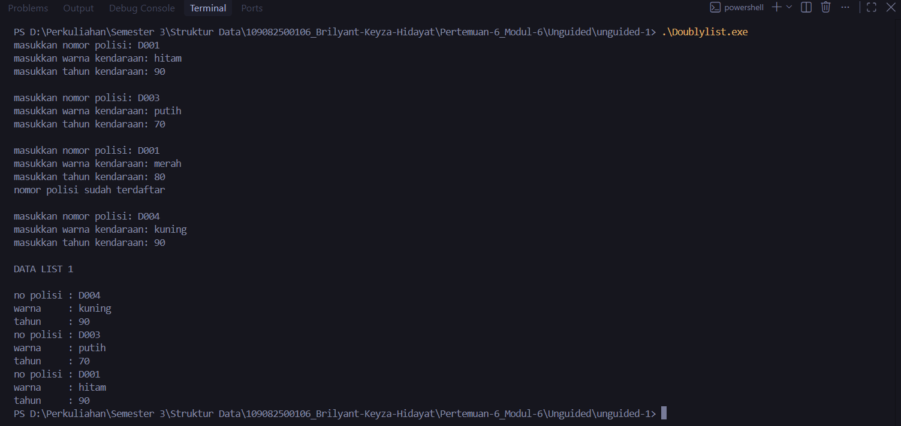
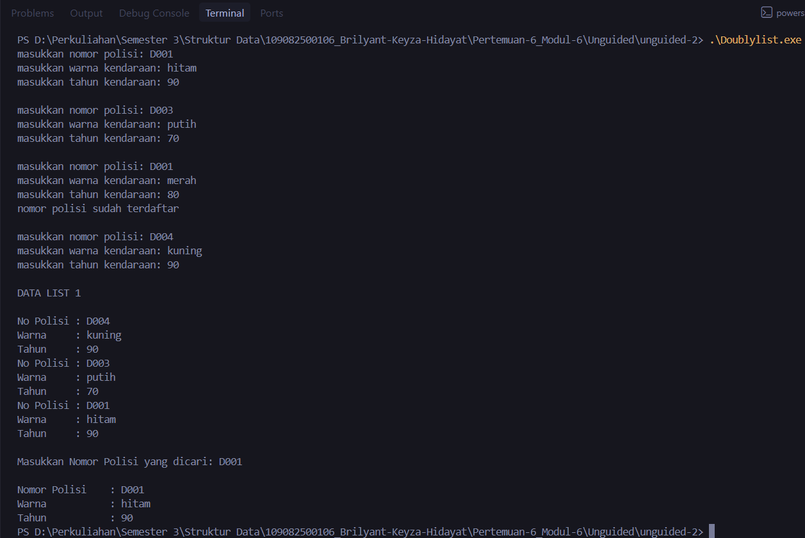
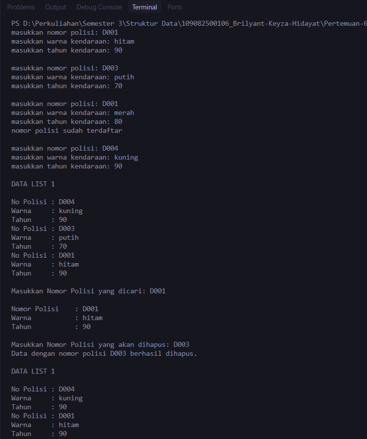

# <h1 align="center">Laporan Praktikum Modul 6 - DOUBLY LINKED LIST (BAGIAN PERTAMA)</h1>
<p align="center">Brilyant Keyza Hidayat - 109082500106</p>

## Dasar Teori

### A. Konsep Dasar Doubly Linked List<br/>
Doubly Linked List adalah salah satu bentuk struktur data linked list di mana masing-masing elemen (simpul) di dalamnya memiliki dua buah successor (pointer penunjuk). Berbeda dengan singly linked list yang hanya bergerak satu arah maju, elemen pada doubly linked list saling terhubung melalui successor yang menunjuk ke elemen sesudahnya (next) dan successor yang menunjuk ke elemen sebelumnya (prev). Dengan adanya dua pointer ini, proses navigasi, akses, dan iterasi antar elemen dapat dilakukan secara fleksibel, baik dengan cara bergerak maju (forward) maupun bergerak mundur (backward) [1].

### B. Komponen dan Struktur ADT Doubly Linked List<br/>
Komponen-komponen dalam Doubly linked list:
- First: Merupakan pointer utama pada list yang bertugas menyimpan alamat dari elemen urutan pertama.

- Last: Merupakan pointer utama pada list yang menyimpan alamat dari elemen urutan paling akhir, sehingga sangat membantu saat dilakukan penyisipan atau penghapusan dari belakang tanpa harus menelusuri data dari awal list.

- Next: Merupakan pointer atau pengait pada setiap elemen (node) yang menunjuk ke alamat memori elemen di depannya.

- Prev: Merupakan pointer pada setiap elemen yang berfungsi sebagai penunjuk arah balik ke elemen di belakangnya. Elemen yang berada di posisi paling pertama (First) akan memiliki pointer prev yang mengarah ke NULL (Nil), sedangkan elemen di posisi paling akhir (Last) memiliki pointer next yang mengarah ke NULL (Nil).

### C. Operasi Dasar (Primitif) Doubly Linked List<br/>
Karena melibatkan dua pointer pada setiap simpul, operasi manipulasi pada doubly linked list memerlukan penyesuaian penyambungan logika pointer ganda. Operasi-operasi utama tersebut meliputi:

- Insert (Penyisipan): Penambahan node baru yang dapat diletakkan di berbagai posisi, seperti di awal list (Insert First), di akhir list (Insert Last), setelah node tertentu (Insert After), maupun tepat sebelum node acuan (Insert Before). Dalam proses Insert First, misalnya, selain menghubungkan pointer next elemen baru ke elemen pertama yang lama, pointer prev elemen lama tersebut juga harus diputar balik menunjuk ke elemen baru.

- Delete (Penghapusan): Proses mencabut dan mendealokasi sebuah simpul dari rantai list. Operasi ini mencakup Delete First, Delete Last, Delete After, dan Delete Before. Saat menghapus sebuah simpul, pointer next dan prev dari simpul-simpul tetangganya harus direkatkan kembali (bypass) untuk memastikan rantai memori tidak terputus.

- Operasi Pendukung (Search, Update, View): Proses pencarian data (searching), pembaruan data (update), dan penelusuran untuk menampilkan (view) pada dasarnya menggunakan logika yang sama dengan singly linked list, namun dengan kelebihan bisa dikembangkan untuk penelusuran dari dua sisi.

## Guided 

### 1. Singly Linked List (List Buah)

#### Doublylist.h
```C++
#ifndef DOUBLYLIST_H
#define DOUBLYLIST_H
#include <string>
using namespace std;

struct barang {
    string kode;
    string nama;
    int tahun;
};

using infotype = barang;
struct elmlist;
using address = elmlist*;
struct elmlist { infotype info; address prev; address next;};
struct list {address first; address last;};

void CreateList(list &L);
address alokasi(const infotype &x);
void dealokasi(address &P);
void insertFirst(list &L, address P);
void insertLast(list &L, address P);
void insertAfter(list &L, address R, address P);
void insertBefore(list &L, address R, address P);
void printInfo(const list &L);
address findElm(const list &L, const string &kode);
void deleteFirst(list &L, address &P);
void deleteLast(list &L, address &P);
void deleteBefore(list &L, address prec, address &P);
void deleteAfter(list &L, address prec, address &P);
#endif
```
#### Doublylist.cpp
```C++
#include <iostream>
#include <iomanip>
#include "Doublylist.h"
using namespace std;

void CreateList(list &L) { L.first = nullptr; L.last = nullptr; }

address alokasi(const infotype &x) {
    address P = new elmlist;
    P->info = x;
    P->prev = nullptr; P->next = nullptr;
    return P;
}
void dealokasi(address &P) {
    if (P != nullptr) { delete P; P = nullptr; }
}
void insertFirst(list &L, address P) {
    if (!P) return;
    P->prev = nullptr; P->next = L.first;
    if (L.first) L.first->prev = P;
    else L.last = P;
    L.first = P;
}
void insertLast(list &L, address P) {
    if (!P) return;
    P->next = nullptr; P->prev = L.last;
    if (L.last) L.last->next = P;
    else L.first = P;
    L.last = P;
}

// Menyisipkan P tepat setelah R.
void insertAfter(list &L, address R, address P) {
    if (!R || !P) return;
    P->prev = R;
    P->next = R->next;
    if (R->next) R->next->prev = P;
    else L.last = P;
    R->next = P;
}

// Menyisipkan P tepat sebelum R.
void insertBefore(list &L, address R, address P) {
    if (!R || !P) return;
    P->next = R;
    P->prev = R->prev;
    if (R->prev) R->prev->next = P;
    else L.first = P;
    R->prev = P;
}
void printInfo(const list &L) {
    address P = L.first;
    if (!P) {
        cout << "List kosong.\n";
        return;
    }

    cout << "+--------+------------+-------+\n";
    cout << "| Kode   | Nama       | Tahun |\n";
    cout << "+--------+------------+-------+\n";
    while (P) {
        cout << "| " << left << setw(6) << P->info.kode
             << " | " << setw(10) << P->info.nama
             << " | " << setw(5) << P->info.tahun << " |\n";
        P = P->next;
    }
    cout << "+--------+------------+-------+\n";
}
address findElm(const list &L, const string &kode) {
    address P = L.first;
    while (P) {
        if (P->info.kode == kode) return P;
        P = P->next;
    }
    return nullptr;
}
void deleteFirst(list &L, address &P) {
    if (!L.first) { P = nullptr; return; }
    P = L.first; L.first = P->next;
    if (L.first) L.first->prev = nullptr;
    else L.last = nullptr;
    P->prev = P->next = nullptr;
}
void deleteLast(list &L, address &P) {
    if (!L.last) { P = nullptr; return; }
    P = L.last; L.last = P->prev;
    if (L.last) L.last->next = nullptr;
    else L.first = nullptr;
    P->prev = P->next = nullptr;
}
// Menghapus node tepat setelah prec.
void deleteAfter(list &L, address prec, address &P) {
    P = nullptr;
    if (!prec || !prec->next) return;
    P = prec->next; prec->next = P->next;
    if (P->next) P->next->prev = prec;
    else L.last = prec;
    P->prev = P->next = nullptr;
}
// Menghapus node tepat sebelum succ.
void deleteBefore(list &L, address succ, address &P) {
    P = nullptr;
    if (!succ || !succ->prev) return;
    P = succ->prev; succ->prev = P->prev;
    if (P->prev) P->prev->next = succ;
    else L.first = succ;
    P->prev = P->next = nullptr;
}
```
#### main.cpp
```C++
#include <iostream>
#include "Doublylist.h"
using namespace std;

void tampilkanJudul(const string &judul) {
    cout << "\n========================================\n";
    cout << judul << '\n';
    cout << "========================================\n";
}

int main() {
    list L;
    CreateList(L);

    infotype barang1 = {"B001", "Laptop", 2020};
    infotype barang2 = {"B002", "Monitor", 2022};
    infotype barang3 = {"B003", "Keyboard", 2023};
    infotype barang4 = {"B004", "Mouse", 2024};

    address P = nullptr;
    address posisi = nullptr;

    cout << "DEMONSTRASI OPERASI DOUBLY LINKED LIST\n";
    cout << "Data yang digunakan: B001, B002, B003, dan B004\n";

    tampilkanJudul("[1] INSERT FIRST");
    cout << "Menambahkan B002 di awal list.\n";
    insertFirst(L, alokasi(barang2));
    printInfo(L);

    tampilkanJudul("[2] INSERT LAST");
    cout << "Menambahkan B004 di akhir list.\n";
    insertLast(L, alokasi(barang4));
    printInfo(L);

    tampilkanJudul("[3] INSERT AFTER");
    cout << "Menambahkan B003 setelah B002.\n";
    posisi = findElm(L, "B002");
    if (posisi != nullptr) {
        insertAfter(L, posisi, alokasi(barang3));
    }
    printInfo(L);

    tampilkanJudul("[4] INSERT BEFORE");
    cout << "Menambahkan B001 sebelum B002.\n";
    posisi = findElm(L, "B002");
    if (posisi != nullptr) {
        insertBefore(L, posisi, alokasi(barang1));
    }
    printInfo(L);

    tampilkanJudul("[5] FIND ELEMENT");
    cout << "Mencari barang dengan kode B003.\n";
    posisi = findElm(L, "B003");
    if (posisi != nullptr) {
        cout << "Data ditemukan:\n";
        cout << "  Kode  : " << posisi->info.kode << '\n';
        cout << "  Nama  : " << posisi->info.nama << '\n';
        cout << "  Tahun : " << posisi->info.tahun << '\n';
    } else {
        cout << "Data tidak ditemukan.\n";
    }

    tampilkanJudul("[6] DELETE AFTER");
    cout << "Menghapus node setelah B002 (B003).\n";
    posisi = findElm(L, "B002");
    deleteAfter(L, posisi, P);
    if (P != nullptr) {
        cout << "Node yang dihapus: " << P->info.kode << '\n';
        dealokasi(P);
    } else {
        cout << "Tidak ada node yang dapat dihapus.\n";
    }
    printInfo(L);

    tampilkanJudul("[7] DELETE BEFORE");
    cout << "Menghapus node sebelum B004 (B002).\n";
    posisi = findElm(L, "B004");
    deleteBefore(L, posisi, P);
    if (P != nullptr) {
        cout << "Node yang dihapus: " << P->info.kode << '\n';
        dealokasi(P);
    } else {
        cout << "Tidak ada node yang dapat dihapus.\n";
    }
    printInfo(L);

    tampilkanJudul("[8] DELETE FIRST");
    cout << "Menghapus node pertama.\n";
    deleteFirst(L, P);
    if (P != nullptr) {
        cout << "Node yang dihapus: " << P->info.kode << '\n';
        dealokasi(P);
    } else {
        cout << "List kosong, tidak ada node yang dapat dihapus.\n";
    }
    printInfo(L);

    tampilkanJudul("[9] DELETE LAST");
    cout << "Menghapus node terakhir.\n";
    deleteLast(L, P);
    if (P != nullptr) {
        cout << "Node yang dihapus: " << P->info.kode << '\n';
        dealokasi(P);
    } else {
        cout << "List kosong, tidak ada node yang dapat dihapus.\n";
    }
    printInfo(L);

    tampilkanJudul("SELESAI");
    cout << "Kondisi list: "
         << (L.first == nullptr && L.last == nullptr ? "kosong.\n" : "masih berisi data.\n");

    return 0;
}
```
Program guided ini berfungsi untuk mendemonstrasikan operasi lengkap pada struktur Doubly Linked List.
Cara kerjanya, pertama program menyiapkan list kosong dengan penanda `first` dan `last`, lalu mengeksekusi serangkaian operasi penyisipan memori (`insertFirst`, `insertLast`, `insertAfter`, dan `insertBefore`) untuk merangkai elemen-elemen baru menggunakan pointer dua arah (`next` dan `prev`). Selanjutnya, program menguji fungsi pencarian (`findElm`) untuk memverifikasi lokasi data, sebelum mendemonstrasikan proses penghapusan elemen dari berbagai sisi list (`deleteAfter`, `deleteBefore`, `deleteFirst`, dan `deleteLast`) dan membersihkannya dari memori. Setiap kali suatu operasi selesai dieksekusi, program akan menampilkan (printInfo) struktur tabel list yang tersisa ke layar untuk menunjukkan histori perubahannya.
## Unguided 

### 1. Buatlah ADT Doubly Linked list sebagai berikut di dalam file “Doublylist.h”:
```
Type infotype : kendaraan <
    nopol : string
    arna : string
    thnBuat : integer
>
Type address : pointer to ElmList
Type ElmList <
    info : infotype
    next :address
    prev : address
>
Type List <
    First : address
    Last : address
>
procedure CreateList( input/output L : List )
function alokasi( x : infotype ) → address
procedure dealokasi(input/output P : address )
procedure printInfo( input L : List )
procedure insertLast(input/output L : List, input P : address )
```
Buatlah implementasi ADT Doubly Linked list pada file “Doublylist.cpp” dan coba hasil
implementasi ADT pada file “main.cpp”.


#### Doublylist.h
```C++
#ifndef DOUBLYLIST_H
#define DOUBLYLIST_H
#include <iostream>
#include <string>

#define Nil NULL
using namespace std;

struct kendaraan {
    string nopol;
    string warna;
    int thnBuat;
};

typedef kendaraan infotype;
typedef struct ElmList *address;

struct ElmList {
    infotype info;
    address next;
    address prev;
};

struct List {
    address First;
    address Last;
};

void CreateList(List &L);
address alokasi(infotype x);
void dealokasi(address &P);
void printInfo(List L);
void insertLast(List &L, address P);
void insertFirst(List &L, address P); 
bool cekDuplikat(List L, string nopol);

#endif
```
#### Doublylist.cpp
```C++
#include <iostream>
#include "Doublylist.h"
using namespace std;

void CreateList(List &L) {
    L.First = Nil;
    L.Last = Nil;
}

address alokasi(infotype x) {
    address P = new ElmList;
    P->info = x;
    P->next = Nil;
    P->prev = Nil;
    return P;
}

void dealokasi(address &P) {
    delete P;
    P = Nil;
}

void insertLast(List &L, address P) {
    if (L.First == Nil) {
        L.First = P;
        L.Last = P;
    } else {
        P->prev = L.Last;
        L.Last->next = P;
        L.Last = P;
    }
}

void insertFirst(List &L, address P) {
    if (L.First == Nil) {
        L.First = P;
        L.Last = P;
    } else {
        P->next = L.First;
        L.First->prev = P;
        L.First = P;
    }
}

void printInfo(List L) {
    address P = L.First;
    cout << "DATA LIST 1\n\n";
    while (P != Nil) {
        cout << "no polisi : " << P->info.nopol << endl;
        cout << "warna     : " << P->info.warna << endl;
        cout << "tahun     : " << P->info.thnBuat << endl;
        P = P->next;
    }
}

bool cekDuplikat(List L, string nopol) {
    address P = L.First;
    while (P != Nil) {
        if (P->info.nopol == nopol) {
            return true;
        }
        P = P->next;
    }
    return false;
}
```
#### main.cpp
```C++
#include <iostream>
#include "Doublylist.h"
using namespace std;

int main() {
    List L;
    CreateList(L);
    
    infotype data;
    address P;

    for (int i = 0; i < 4; i++) {
        cout << "masukkan nomor polisi: ";
        cin >> data.nopol;
        cout << "masukkan warna kendaraan: ";
        cin >> data.warna;
        cout << "masukkan tahun kendaraan: ";
        cin >> data.thnBuat;
        
        if (cekDuplikat(L, data.nopol)) {
            cout << "nomor polisi sudah terdaftar\n\n";
        } else {
            P = alokasi(data);
            insertFirst(L, P); 
            cout << endl;
        }
    }
    
    printInfo(L);
    
    return 0;
}
```
### Output Unguided 1 :

##### Output 1


Program ini berfungsi untuk mencatat dan mengelola data kendaraan menggunakan struktur Doubly Linked List yang mengimplementasikan dua arah penunjuk elemen, yaitu pointer `next` dan `prev`, serta menggunakan penanda `First` dan `Last` pada list utama. Secara cara kerjanya, program akan mengalokasikan memori untuk data baru dan memvalidasi input agar tidak ada data nomor polisi yang duplikat. Terkait penerapan operasinya, program ini secara khusus mengeksekusi operasi `insertFirst` untuk menyisipkan data ke posisi paling awal dengan cara merangkai pointer `next` dan `prev` secara dinamis, meskipun deklarasi fungsi `insertLast` juga disiapkan di dalam strukturnya. Pada tahap akhir, program memanggil operasi penelusuran `printInfo` yang bergerak maju menggunakan pointer `next` untuk mencetak seluruh daftar kendaraan dari urutan input terbaru hingga yang terlama.

### 2. Carilah elemen dengan nomor polisi D001 dengan membuat fungsi baru. 
fungsi findElm( L : List, x : infotype ) : address

#### Doublylist.h
```C++
#ifndef DOUBLYLIST_H
#define DOUBLYLIST_H
#include <iostream>
#include <string>

#define Nil NULL
using namespace std;

struct kendaraan {
    string nopol;
    string warna;
    int thnBuat;
};

typedef kendaraan infotype;
typedef struct ElmList *address;

struct ElmList {
    infotype info;
    address next;
    address prev;
};

struct List {
    address First;
    address Last;
};

void CreateList(List &L);
address alokasi(infotype x);
void dealokasi(address &P);
void printInfo(List L);
void insertLast(List &L, address P);
void insertFirst(List &L, address P); 
bool cekDuplikat(List L, string nopol);
// Tambahan fungsi untuk soal nomor 2
address findElm(List L, infotype x);

#endif
```
#### Doublylist.cpp
```C++
#include <iostream>
#include "Doublylist.h"
using namespace std;

void CreateList(List &L) {
    L.First = Nil;
    L.Last = Nil;
}

address alokasi(infotype x) {
    address P = new ElmList;
    P->info = x;
    P->next = Nil;
    P->prev = Nil;
    return P;
}

void dealokasi(address &P) {
    delete P;
    P = Nil;
}

void insertLast(List &L, address P) {
    if (L.First == Nil) {
        L.First = P;
        L.Last = P;
    } else {
        P->prev = L.Last;
        L.Last->next = P;
        L.Last = P;
    }
}

void insertFirst(List &L, address P) {
    if (L.First == Nil) {
        L.First = P;
        L.Last = P;
    } else {
        P->next = L.First;
        L.First->prev = P;
        L.First = P;
    }
}

void printInfo(List L) {
    address P = L.First;
    cout << "DATA LIST 1\n\n";
    while (P != Nil) {
        cout << "No Polisi : " << P->info.nopol << endl;
        cout << "Warna     : " << P->info.warna << endl;
        cout << "Tahun     : " << P->info.thnBuat << endl;
        P = P->next;
    }
}

bool cekDuplikat(List L, string nopol) {
    address P = L.First;
    while (P != Nil) {
        if (P->info.nopol == nopol) {
            return true;
        }
        P = P->next;
    }
    return false;
}

// Tambahan untuk soal no 2
address findElm(List L, infotype x) {
    address P = L.First;
    while (P != Nil) {
        if (P->info.nopol == x.nopol) {
            return P;
        }
        P = P->next;
    }
    return Nil; 
}
```
#### main.cpp
```C++
#include <iostream>
#include "Doublylist.h"
using namespace std;

int main() {
    List L;
    CreateList(L);
    
    infotype data;
    address P;

    for (int i = 0; i < 4; i++) {
        cout << "masukkan nomor polisi: ";
        cin >> data.nopol;
        cout << "masukkan warna kendaraan: ";
        cin >> data.warna;
        cout << "masukkan tahun kendaraan: ";
        cin >> data.thnBuat;
        
        if (cekDuplikat(L, data.nopol)) {
            cout << "nomor polisi sudah terdaftar\n\n";
        } else {
            P = alokasi(data);
            insertFirst(L, P); 
            cout << endl;
        }
    }
    
    printInfo(L);
    
    // Tambahan untuk soal no 2
    cout << "\n";
    infotype dataCari;
    cout << "Masukkan Nomor Polisi yang dicari: ";
    cin >> dataCari.nopol;
    cout << "\n";
    
    address ketemu = findElm(L, dataCari);
    
    if (ketemu != Nil) {
        cout << "Nomor Polisi \t: " << ketemu->info.nopol << endl;
        cout << "Warna \t\t: " << ketemu->info.warna << endl;
        cout << "Tahun \t\t: " << ketemu->info.thnBuat << endl;
    } else {
        cout << "Data tidak ditemukan." << endl;
    }
    
    return 0;
}
```
### Output Unguided 2 :

##### Output 1


Program ini merupakan pengembangan dari struktur Doubly Linked List sebelumnya yang kini mengimplementasikan operasi pencarian data (searching) secara spesifik. Terkait penerapannya, program menggunakan fungsi `findElm` yang memanfaatkan pergeseran pointer `next` untuk melakukan penelusuran elemen secara sekuensial (berurutan) dimulai dari penanda `First` hingga mencapai batas akhir `Nil`. Secara cara kerjanya, program akan meminta pengguna memasukkan target nomor polisi yang dicari, lalu fungsi tersebut akan membandingkan inputan dengan setiap data di dalam list; jika ditemukan kecocokan, program akan langsung mengembalikan alamat memori (address) dari simpul tersebut dan mencetak rincian informasi kendaraannya ke layar utama.

### 3. Hapus elemen dengan nomor polisi D003 dengan procedure delete.
- procedure deleteFirst( input/output L : List, P : address )
- procedure deleteLast( input/output L : List, P : address )
- procedure deleteAfter( input Prec : address, input/output P : address )

#### Doublylist.h
```C++
#ifndef DOUBLYLIST_H
#define DOUBLYLIST_H
#include <iostream>
#include <string>

#define Nil NULL
using namespace std;

struct kendaraan {
    string nopol;
    string warna;
    int thnBuat;
};

typedef kendaraan infotype;
typedef struct ElmList *address;

struct ElmList {
    infotype info;
    address next;
    address prev;
};

struct List {
    address First;
    address Last;
};

void CreateList(List &L);
address alokasi(infotype x);
void dealokasi(address &P);
void printInfo(List L);
void insertLast(List &L, address P);
void insertFirst(List &L, address P); 
bool cekDuplikat(List L, string nopol);
// Tambahan fungsi untuk soal nomor 2
address findElm(List L, infotype x);
// Tambahan prosedur untuk soal nomor 3
void deleteFirst(List &L, address &P);
void deleteLast(List &L, address &P);
void deleteAfter(address Prec, address &P);

#endif
```
#### Doublylist.cpp
```C++
#include <iostream>
#include "Doublylist.h"
using namespace std;

void CreateList(List &L) {
    L.First = Nil;
    L.Last = Nil;
}

address alokasi(infotype x) {
    address P = new ElmList;
    P->info = x;
    P->next = Nil;
    P->prev = Nil;
    return P;
}

void dealokasi(address &P) {
    delete P;
    P = Nil;
}

void insertLast(List &L, address P) {
    if (L.First == Nil) {
        L.First = P;
        L.Last = P;
    } else {
        P->prev = L.Last;
        L.Last->next = P;
        L.Last = P;
    }
}

void insertFirst(List &L, address P) {
    if (L.First == Nil) {
        L.First = P;
        L.Last = P;
    } else {
        P->next = L.First;
        L.First->prev = P;
        L.First = P;
    }
}

void printInfo(List L) {
    address P = L.First;
    cout << "DATA LIST 1\n\n";
    while (P != Nil) {
        cout << "No Polisi : " << P->info.nopol << endl;
        cout << "Warna     : " << P->info.warna << endl;
        cout << "Tahun     : " << P->info.thnBuat << endl;
        P = P->next;
    }
}

bool cekDuplikat(List L, string nopol) {
    address P = L.First;
    while (P != Nil) {
        if (P->info.nopol == nopol) {
            return true;
        }
        P = P->next;
    }
    return false;
}

// Tambahan untuk soal nomor 2
address findElm(List L, infotype x) {
    address P = L.First;
    while (P != Nil) {
        if (P->info.nopol == x.nopol) {
            return P;
        }
        P = P->next;
    }
    return Nil; 
}

// Tambahan untuk soal no 3
void deleteFirst(List &L, address &P) {
    P = L.First;
    if (L.First == L.Last) { 
        L.First = Nil;
        L.Last = Nil;
    } else {
        L.First = P->next;
        L.First->prev = Nil;
        P->next = Nil;
    }
}

void deleteLast(List &L, address &P) {
    P = L.Last;
    if (L.First == L.Last) {
        L.First = Nil;
        L.Last = Nil;
    } else {
        L.Last = P->prev;
        L.Last->next = Nil;
        P->prev = Nil;
    }
}

void deleteAfter(address Prec, address &P) {
    P = Prec->next;
    Prec->next = P->next;
    if (P->next != Nil) {
        P->next->prev = Prec;
    }
    P->next = Nil;
    P->prev = Nil;
}
```
#### main.cpp
```C++
#include <iostream>
#include "Doublylist.h"
using namespace std;

int main() {
    List L;
    CreateList(L);
    
    infotype data;
    address P;

    for (int i = 0; i < 4; i++) {
        cout << "masukkan nomor polisi: ";
        cin >> data.nopol;
        cout << "masukkan warna kendaraan: ";
        cin >> data.warna;
        cout << "masukkan tahun kendaraan: ";
        cin >> data.thnBuat;
        
        if (cekDuplikat(L, data.nopol)) {
            cout << "nomor polisi sudah terdaftar\n\n";
        } else {
            P = alokasi(data);
            insertFirst(L, P); 
            cout << endl;
        }
    }
    
    printInfo(L);
    
    // Tambahan untuk soal no 2
    cout << "\n";
    infotype dataCari;
    cout << "Masukkan Nomor Polisi yang dicari: ";
    cin >> dataCari.nopol;
    cout << "\n";
    
    address ketemu = findElm(L, dataCari);
    
    if (ketemu != Nil) {
        cout << "Nomor Polisi \t: " << ketemu->info.nopol << endl;
        cout << "Warna \t\t: " << ketemu->info.warna << endl;
        cout << "Tahun \t\t: " << ketemu->info.thnBuat << endl;
    } else {
        cout << "Data tidak ditemukan." << endl;
    }

    // Tambahan untuk soal no 3
    cout << "\n";
    infotype hapusData;
    cout << "Masukkan Nomor Polisi yang akan dihapus: ";
    cin >> hapusData.nopol;
    
    address nodeHapus = findElm(L, hapusData);
    
    if (nodeHapus != Nil) {
        address P_del;
        if (nodeHapus == L.First) {
            deleteFirst(L, P_del);
        } else if (nodeHapus == L.Last) {
            deleteLast(L, P_del);
        } else {
            address Prec = nodeHapus->prev;
            deleteAfter(Prec, P_del);
        }
        
        dealokasi(P_del);
        cout << "Data dengan nomor polisi " << hapusData.nopol << " berhasil dihapus.\n\n";
    } else {
        cout << "Data tidak ditemukan.\n\n";
    }
    
    printInfo(L);
    
    return 0;
}
```
### Output Unguided 3 :

##### Output 1


Program ini merupakan pengembangan struktur Doubly Linked List program sebelumnya yang kini mengimplementasikan operasi penghapusan elemen data secara dinamis. Terkait penerapannya, program ini menggunakan kombinasi tiga operasi sekaligus, yaitu `deleteFirst` untuk mencabut simpul di awal list, `deleteLast` untuk simpul di akhir list, serta `deleteAfter` untuk simpul di tengah dengan memanfaatkan pointer `prev` sebagai acuan posisi data sebelumnya (Prec). Secara cara kerjanya, program akan mencari terlebih dahulu alamat nomor polisi yang ingin dihapus, lalu secara otomatis mengevaluasi posisi node tersebut untuk menentukan prosedur delete mana yang paling tepat dieksekusi guna memutus rangkaian pointer dua arahnya dengan aman, sebelum akhirnya membebaskan memori melalui dealokasi dan mencetak pembaruan sisa data kendaraan ke layar utama.

## Kesimpulan
Kesimpulannya pada praktikum Modul 6, pemahaman mengenai Doubly Linked List sangat penting untuk meningkatkan fleksibilitas navigasi data karena memungkinkan penelusuran secara dua arah (maju dan mundur). Penerapannya sangat bergantung pada penguasaan manajemen pointer ganda pada setiap elemen, yaitu next dan prev, serta pemanfaatan penanda utama First dan Last. Melalui latihan unguided, penguasaan logika perangkaian pointer ganda ini terbukti sangat krusial saat mengeksekusi operasi penyisipan (insert) dan penghapusan (delete) di berbagai posisi baik di awal, di akhir, maupun di tengah list (after/before) karena memori harus diputus dan disambung kembali tanpa memutus rantai data. Secara keseluruhan, implementasi operasi ini ke dalam studi kasus nyata seperti manajemen pendataan kendaraan (unguided) dan barang elektronik (guided) menunjukkan bahwa Doubly Linked List menghasilkan sistem penyimpanan data yang jauh lebih efisien untuk diakses dan dimodifikasi, sekaligus menjadi fondasi yang kuat untuk merancang arsitektur struktur data yang lebih kompleks.

## Referensi
[1] Pradhana, R., & Wibowo, S. (2021). Analisis Kinerja dan Optimasi Pencarian Data Dua Arah Menggunakan Struktur Data Doubly Linked List. Jurnal Teknologi Informasi dan Ilmu Komputer (JTIIK), 8(3), 205-212.
<br>[2] Modul 6: Modul 6 Doubly Linked List (BAGIAN PERTAMA). Modul Praktikum Struktur Data. (Referensi Modul).
<br>
