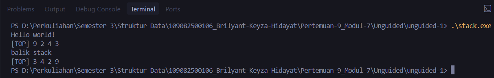
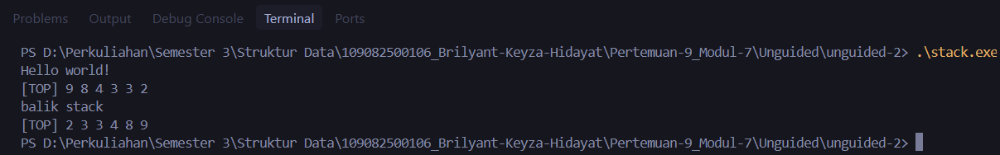
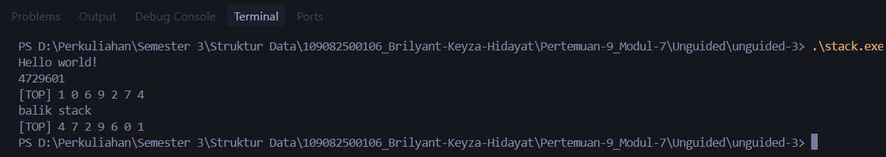

# <h1 align="center">Laporan Praktikum Modul 7 - STACK</h1>
<p align="center">Brilyant Keyza Hidayat - 109082500106</p>

## Dasar Teori

### A. Pengertian Stack<br/>
Stack atau tumpukan merupakan salah satu bentuk struktur data di mana prinsip operasi yang digunakan bekerja seperti tumpukan barang. Elemen yang pertama kali masuk akan menjadi elemen yang paling terakhir diambil, atau sebaliknya, elemen yang terakhir kali dimasukkan akan menjadi elemen pertama yang diambil. Prinsip ini secara umum dikenal dengan istilah LIFO (*Last In First Out*) [1]. 

### B. Komponen dan Representasi Stack<br/>
Komponen-komponen dalam struktur data stack pada dasarnya sangat mirip dengan komponen pada *Singly Linked List*. Namun, hak akses pada stack sangat terbatas karena manipulasi data (penambahan maupun pengambilan) hanya bisa dilakukan pada satu ujung, yaitu titik teratas stack yang disebut sebagai **TOP** [2]. 

Terdapat dua cara untuk merepresentasikan stack:
1. **Representasi Pointer (Linked List):** Menggunakan alokasi memori dinamis di mana setiap elemen saling terhubung melalui pointer `next`.
2. **Representasi Tabel (Array):** Menggunakan array berindeks dengan kapasitas tetap (*Imax*), di mana pergeseran data diatur dengan menaikkan atau menurunkan nilai indeks penunjuk TOP.

### C. Operasi-Operasi Utama dalam Stack<br/>
Dalam stack, terdapat dua operasi paling mendasar, yaitu:
- **Push (Penyisipan):** Operasi untuk memasukkan atau menambahkan elemen baru ke dalam tumpukan data. Nilai TOP akan bergeser ke atas (bertambah) sebelum atau sesudah data disisipkan, menjadikannya elemen teratas yang baru.
- **Pop (Pengambilan):** Operasi untuk mengambil atau menghapus elemen dari tumpukan data. Data yang diambil selalu merupakan elemen yang berada pada posisi TOP. Setelah data diambil, indeks TOP akan diturunkan (berkurang 1) untuk menunjuk pada elemen di bawahnya.

## Guided 

### 1. Guided 1

#### stack.h
```C++
#include <iostream>
#ifndef STACK_H_INCLUDED
#define STACK_H_INCLUDED
using namespace std;

struct infotype {
    char nim[20];
    char nama[20];
};
struct Stack {
    infotype info[10];
    int Top;
};
/* prototype */
/******** pengecekan apakah Stack kosong *********/
int isEmpty(Stack S);
/* mengembalikan nilai 0 jika stack kosong */
/******** pembuatan Stack ********/
void createStack(Stack &S);
/* I.S. sembarang
F.S. terbentuk stack dengan Top=0 */
/******** penambahan elemen pada Stack ********/
void push(Stack &S, infotype X);
/* I.S. Stack mungkin kosong
F.S. menambahkan elemen pada stack dengan nilai X, TOP=TOP+1 */
/******** penghapusan elemen pada list ********/
void pop(Stack &S, infotype &X);
/* I.S. stack tidak kosong
F.S. nilai info pada indeks TOP disimpan pada X, kemudian TOP=TOP-1 */
/******** proses semua elemen list *********/
void viewStack(Stack S);
/* I.S. stack mungkin kosong
F.S. jika stack tidak kosong menampilkan semua info yang ada pada stack
*/
#endif // STACK_H_INCLUDED
```

#### stack.cpp
```C++
#include "stack.h"

int isEmpty(Stack S) {
    if (S.Top == 0) {
        return 0;
    }else {
        return 1;
    }
}

void createStack(Stack &S) {
    S.Top = 0;
}

void push(Stack &S, infotype X) {
    if (S.Top < 10) {
        S.Top = S.Top + 1;
        S.info[S.Top - 1] = X;
    } else {
        cout << "Stack penuh, data tidak bisa ditambahkan" <<endl;
    }
}

void pop(Stack &S, infotype &X) {
    if (isEmpty(S) != 0) {
        X = S.info[S.Top - 1];
        S.Top = S.Top - 1;
    } else {
        cout << "Stack kosong, tidak ada data yang bisa diambil" << endl;
    }
}

void viewStack(Stack S) {
    if (isEmpty(S) == 0) {
        cout << "Stack kosong" <<endl;
    } else {
        cout << "Isi stack (dari TOP): " <<endl;
        for (int i = S.Top; i >= 1; i--) {
            cout << i << ". " << S.info[i - 1].nim << " - " << S.info[i - 1].nama << endl;
        }
    }
}
```

#### main.cpp
```C++
#include <iostream>
#include <cstring>
#include "stack.h"
using namespace std;

int main() {
    Stack S;
    infotype data, hasil;

    createStack(S);
    cout << "Stack baru dibuat, Top = " << S.Top << endl;
    viewStack(S);

    cout << endl << "--- Push 3 data ---" << endl;
    strcpy(data.nim, "103112400001");
    strcpy(data.nama, "Andi");
    push(S, data);

    strcpy(data.nim, "103112400002");
    strcpy(data.nama, "Budi");
    push(S, data);

    strcpy(data.nim, "103112400003");
    strcpy(data.nama, "Citra");
    push(S, data);
    viewStack(S);

    cout << endl << "--- Pop 1 data ---" << endl;
    pop(S, hasil);
    cout << "Data yang diambil: " << hasil.nim << " - " << hasil.nama << endl;
    viewStack(S);

    cout << endl << "--- Pop sampai kosong ---" << endl;
    pop(S, hasil);
    pop(S, hasil);
    pop(S, hasil);
    viewStack(S);

    return 0;
}
```
Program guided di atas merupakan implementasi struktur data Stack menggunakan representasi Tabel (Array) statis dengan kapasitas maksimal 10 data. Program ini mendemonstrasikan bagaimana fungsi primitif stack bekerja, meliputi inisialisasi awal (`createStack`), pengecekan kekosongan (`isEmpty`), penyisipan data mahasiswa yang berisi NIM dan Nama ke posisi teratas (`push`), hingga pengambilan data teratas sekaligus menurunkan indikator posisi tumpukannya (`pop`).

## Unguided 

### 1. Buatlah ADT Stack menggunakan ARRAY sebagai berikut di dalam file "stack.h":
Buatlah implementasi ADT Stack menggunakan Array pada file "stack.cpp" dan "main.cpp"

#### stack.h
```C++
#ifndef STACK_H
#define STACK_H
#include <iostream>
using namespace std;

typedef int infotype;

struct Stack {
    infotype info[20];
    int top;
};

void createStack(Stack &S);
void push(Stack &S, infotype x);
infotype pop(Stack &S);
void printInfo(Stack S);
void balikStack(Stack &S);

#endif
```

#### stack.cpp
```C++
#include "stack.h"

void createStack(Stack &S) {
    S.top = 0;
}

void push(Stack &S, infotype x) {
    if (S.top < 20) {
        S.info[S.top] = x;
        S.top++;
    } else {
        cout << "Stack Penuh\n";
    }
}

infotype pop(Stack &S) {
    if (S.top > 0) {
        S.top--;
        return S.info[S.top];
    }
    return -1;
}

void printInfo(Stack S) {
    cout << "[TOP] ";
    for (int i = S.top - 1; i >= 0; i--) {
        cout << S.info[i] << " ";
    }
    cout << endl;
}

void balikStack(Stack &S) {
    int temp;
    for (int i = 0; i < S.top / 2; i++) {
        temp = S.info[i];
        S.info[i] = S.info[S.top - 1 - i];
        S.info[S.top - 1 - i] = temp;
    }
}
```

#### main.cpp
```C++
#include <iostream>
#include "stack.h"
using namespace std;

int main() {
    cout << "Hello world!" << endl;
    Stack S;
    createStack(S);
    push(S, 3);
    push(S, 4);
    push(S, 8);
    pop(S);
    push(S, 2);
    push(S, 3);
    pop(S);
    push(S, 9);
    
    printInfo(S);
    cout << "balik stack" << endl;
    balikStack(S);
    printInfo(S);
    
    return 0;
}
```
### Output Unguided 1 :

##### Output 1


Program ini berfungsi untuk memodelkan struktur Stack yang menyimpan data bertipe integer menggunakan array berkapasitas 20 elemen. Cara kerjanya berfokus pada manipulasi indeks `top`, di mana operasi penyisipan (`push`) dilakukan dengan menaruh nilai di urutan teratas lalu menaikkan indeksnya, dan operasi (`pop`) mengurangi indeks penunjuk tersebut. Terdapat operasi khusus berupa `balikStack` yang membalikkan urutan posisi seluruh memori dari indeks awal (`0`) hingga ujung (`top-1`) menggunakan logika pertukaran *array*.

---

### 2. Tambahkan prosedur pushAscending(in/out S: Stack, in x : integer)

#### stack.h
```C++
#ifndef STACK_H
#define STACK_H
#include <iostream>
using namespace std;

typedef int infotype;

struct Stack {
    infotype info[20];
    int top;
};

void createStack(Stack &S);
void push(Stack &S, infotype x);
infotype pop(Stack &S);
void printInfo(Stack S);
void balikStack(Stack &S);

// Tambahan Prosedur untuk Soal 2
void pushAscending(Stack &S, infotype x);

#endif
```

#### stack.cpp
```C++
#include "stack.h"

void createStack(Stack &S) {
    S.top = 0;
}

void push(Stack &S, infotype x) {
    if (S.top < 20) {
        S.info[S.top] = x;
        S.top++;
    } else {
        cout << "Stack Penuh\n";
    }
}

infotype pop(Stack &S) {
    if (S.top > 0) {
        S.top--;
        return S.info[S.top];
    }
    return -1;
}

void printInfo(Stack S) {
    cout << "[TOP] ";
    for (int i = S.top - 1; i >= 0; i--) {
        cout << S.info[i] << " ";
    }
    cout << endl;
}

void balikStack(Stack &S) {
    int temp;
    for (int i = 0; i < S.top / 2; i++) {
        temp = S.info[i];
        S.info[i] = S.info[S.top - 1 - i];
        S.info[S.top - 1 - i] = temp;
    }
}

// Fungsi tambahan untuk Soal no 2
void pushAscending(Stack &S, infotype x) {
    Stack tempStack;
    createStack(tempStack);

    while (S.top > 0 && S.info[S.top - 1] > x) {
        push(tempStack, pop(S));
    }

    push(S, x);

    while (tempStack.top > 0) {
        push(S, pop(tempStack));
    }
}
```

#### main.cpp
```C++
#include <iostream>
#include "stack.h"
using namespace std;

int main() {
    cout << "Hello world!" << endl;
    Stack S;
    createStack(S);
    
    pushAscending(S, 3);
    pushAscending(S, 4);
    pushAscending(S, 8);
    pushAscending(S, 2);
    pushAscending(S, 3);
    pushAscending(S, 9);
    
    printInfo(S);
    cout << "balik stack" << endl;
    balikStack(S);
    printInfo(S);
    
    return 0;
}
```
### Output Unguided 2 :

##### Output 1


Program ini merupakan pembaruan dari modul stack yang kini mengimplementasikan metode penyisipan data terurut atau `pushAscending`. Secara cara kerjanya, program mencegah masuknya nilai baru di tempat yang salah dengan memanfaatkan sebuah *stack* sementara (tempStack) guna menampung sementara data di posisi TOP yang lebih besar dari inputan *user*. Begitu posisi yang sesuai ditemukan untuk disisipkan, program akan mengembalikan sisa isi dari *stack* sementara tadi, sehingga struktur utama tetap terjaga agar selalu tersusun membesar (Ascending) dari bawah ke atas.

---

### 3. Tambahkan prosedur getInputStream(in/out S: Stack). 
Prosedur akan terus membaca dan menerima input user dan memasukkan setiap input ke dalam stack hingga user menekan tombol enter. Contoh: gunakan cin.get() untuk mendapatkan inputan user.

#### stack.h
```C++
#ifndef STACK_H
#define STACK_H
#include <iostream>
using namespace std;

typedef int infotype;

struct Stack {
    infotype info[20];
    int top;
};

void createStack(Stack &S);
void push(Stack &S, infotype x);
infotype pop(Stack &S);
void printInfo(Stack S);
void balikStack(Stack &S);
void pushAscending(Stack &S, infotype x);

// Tambahan Prosedur untuk Soal 3
void getInputStream(Stack &S);

#endif
```

#### stack.cpp
```C++
#include "stack.h"

void createStack(Stack &S) {
    S.top = 0;
}

void push(Stack &S, infotype x) {
    if (S.top < 20) {
        S.info[S.top] = x;
        S.top++;
    } else {
        cout << "Stack Penuh\n";
    }
}

infotype pop(Stack &S) {
    if (S.top > 0) {
        S.top--;
        return S.info[S.top];
    }
    return -1;
}

void printInfo(Stack S) {
    cout << "[TOP] ";
    for (int i = S.top - 1; i >= 0; i--) {
        cout << S.info[i] << " ";
    }
    cout << endl;
}

void balikStack(Stack &S) {
    int temp;
    for (int i = 0; i < S.top / 2; i++) {
        temp = S.info[i];
        S.info[i] = S.info[S.top - 1 - i];
        S.info[S.top - 1 - i] = temp;
    }
}

void pushAscending(Stack &S, infotype x) {
    Stack tempStack;
    createStack(tempStack);

    while (S.top > 0 && S.info[S.top - 1] > x) {
        push(tempStack, pop(S));
    }

    push(S, x);

    while (tempStack.top > 0) {
        push(S, pop(tempStack));
    }
}

// Fungsi tambahan untuk soal no 3
void getInputStream(Stack &S) {
    char ch;
    while (cin.get(ch) && ch != '\n') {
        if (ch >= '0' && ch <= '9') {
            push(S, ch - '0');
        }
    }
}
```

#### main.cpp
```C++
#include <iostream>
#include "stack.h"
using namespace std;

int main() {
    cout << "Hello world!" << endl;
    Stack S;
    createStack(S);
    getInputStream(S);
    
    printInfo(S);
    cout << "balik stack" << endl;
    balikStack(S);
    printInfo(S);
    
    return 0;
}
```
### Output Unguided 3 :

##### Output 1


Program ini menambahkan fitur penangkapan *input* serentak melalui manipulasi aliran data `getInputStream`. Secara cara kerjanya, program membaca pengetikan dari *keyboard* karakter demi karakter secara perulangan tanpa spasi menggunakan `cin.get()` dan perulangan tersebut akan berhenti apabila tombol `Enter` (`\n`) ditekan. Setiap karakter angka yang tertangkap langsung dikonversi ke tipe bilangan (*integer*) dan di-`push` satu per satu untuk direkam bertumpuk ke dalam *stack* yang menghasilkan kebalikan deret input di cetakan.

## Kesimpulan
Kesimpulannya pada praktikum Modul 7, pemahaman tentang *Stack* memberikan landasan penting mengenai pengorganisasian data secara linear yang berpegang teguh pada prinsip pengaksesan LIFO (*Last In First Out*). Pengimplementasian manipulasi list ini hanya membutuhkan *pointer* acuan tunggal yang disebut `TOP` untuk menyederhanakan siklus alur datanya. Melalui pengerjaan *guided* dan *unguided*, terbukti bahwa tumpukan dapat dipresentasikan secara efisien ke dalam dua bentuk, yakni bentuk dinamis berbasis rekursif *Pointer* atau menggunakan pengindeksan terbatas dari tabel (Array). Selain itu, pemanfaatan *Stack* sangat efektif ketika memecahkan algoritma terstruktur seperti merutinkan penyimpanan yang terurut (`pushAscending`), maupun dalam skenario operasi *buffering* menangkap aliran karakter secara kontinu (`getInputStream`).

## Referensi
[1] Sihombing, J. (2019). Penerapan Struktur Data Stack Pada Aplikasi Parser HTML. *Jurnal Ilmiah Core IT: Community Research Information Technology*, 7(1), 15-20.
<br>[2] Modul 7: Modul 7 STACK. Modul Praktikum Struktur Data (Referensi Modul). 
<br>